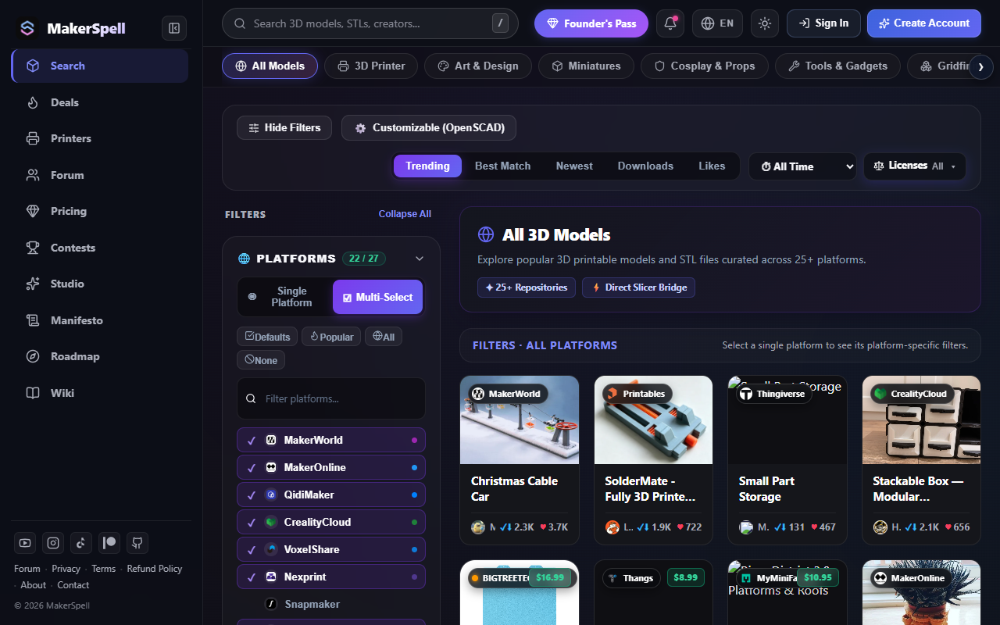

# 🔎 26 Platformda 3D Model Arama & Filtreleme Rehberi

MakerSpell Arama Motoru, internetteki onlarca farklı model platformu arasında tek tek gezme zahmetini ortadan kaldırır.

---

## 1. Nasıl Arama Yapılır?

1. [makerspell.com/browse](https://www.makerspell.com/browse) adresine gidin veya ana sayfadaki arama çubuğunu kullanın.
2. Aramak istediğiniz modeli yazın (Örn: *phone stand*, *articulated dragon*, *organizer*).
3. Arama kutusunda Enter'a basın veya arama butonuna tıklayın.

---

## 2. Akıllı Filtreler ve Sıralama

- **Ücretsiz / Ücretli Filtresi:** Yalnızca ücretsiz indirilebilir STL dosyalarını veya ticari modelleri listelemek için filtre haplarını kullanabilirsiniz.
- **Platform Seçimi:** İstediğiniz platformları (Örn: Yalnızca *Printables* ve *Thingiverse*) seçebilir veya hepsinde aynı anda arama yapabilirsiniz.
- **Sıralama Seçenekleri:** En popüler modeller, en son eklenenler veya en çok indirilenlere göre listeleyin.
- **Hızlı Önizleme:** Model kartına tıkladığınızda 3D görsel önizlemeyi, lisans türünü ve yazar bilgilerini inceleyebilir; tek tıkla orijinal indirme sayfasına gidebilirsiniz.

