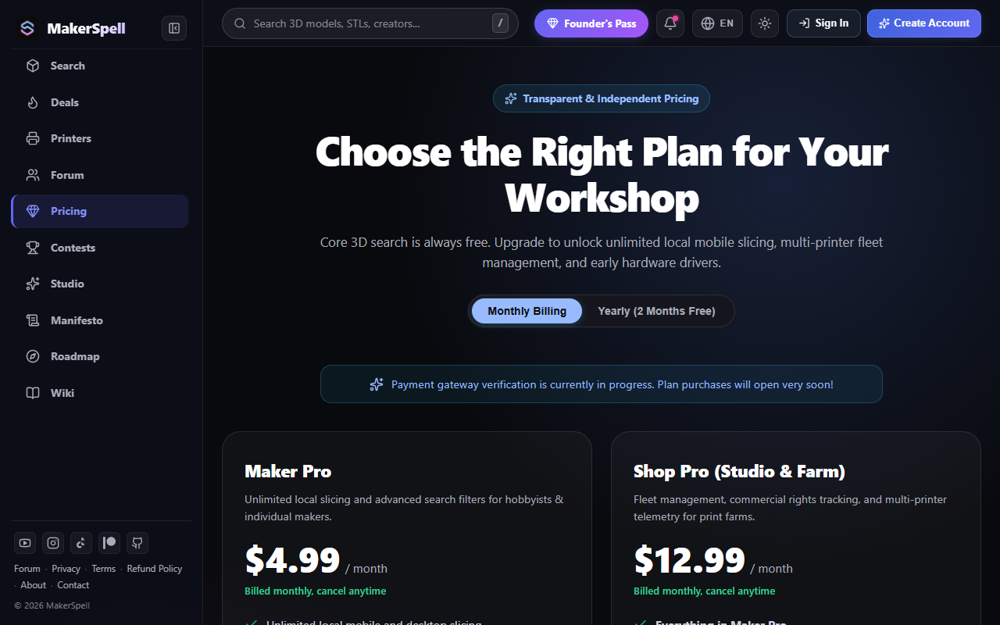

# 💎 Fiyatlandırma, Kurucu Üyelik & Abonelik Paketleri

MakerSpell, her seviyedeki üretici için adil ve esnek üyelik planları sunar.

---

## 1. Üyelik Seviyeleri

- **Ücretsiz Plan (Free):**
  - 26 model platformunda sınırsız arama ve temel filtreleme.
  - Tek 3D yazıcı bağlama ve temel telemetri takibi.
  - Topluluk indirimlerini ve kuponları görüntüleme.
- **Maker Pro ($4.99 / ay):**
  - Sınırsız sayıda yazıcı bağlama ve merkezi çiftlik (farm) yönetimi.
  - Canlı kamera yayını ve bulutsuz yerel köprüleme.
  - Gelişmiş arama filtreleri ve STL dosya boyutu optimizasyonu.
- **Shop Pro ($12.99 / ay):**
  - E-ticaret sipariş entegrasyonu (Shop Hub).
  - Çoklu sipariş kuyruğu ve otomatik iş dağıtımı.
  - Öncelikli teknik destek ve SLA garantisi.

---

## 2. Sınırlı Sayıda "Lifetime Founder's Pass" (Kurucu Üye)

Erken aşamada projemize güvenen ilk 200 destekçiye özel tek seferlik ömür boyu lisans:
- Aylık veya yıllık abonelik ödemesi yok; bir kere ödeyip ömür boyu Pro özelliklerine sahip olun.
- Kurucu üye rozeti ve Discord özel geliştirici kanallarına erişim.
- Yeni çıkacak tüm yapay zeka ve kamera özelliklerine ilk gün ücretsiz erişim hakkı.

