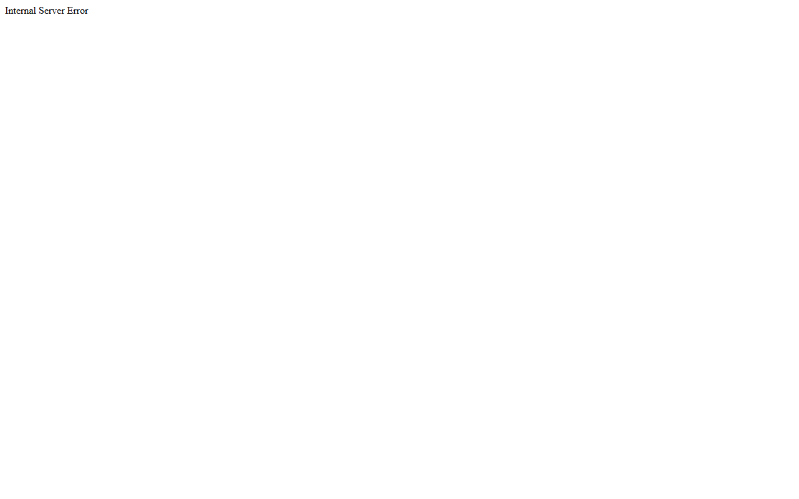

# MakerSpell Wiki Bilgi Portalı

**MakerSpell Wiki** ([wiki.makerspell.com](https://wiki.makerspell.com)), 3D yazıcı kullanıcıları, yapımcılar (makers) ve atölye yöneticileri için özel olarak geliştirilmiş bağımsız bir açık donanım bilgi portalıdır.

---

## Öne Çıkan Özellikler

1. **3 Kolonlu Odaklanmış Navigasyon:**
   - **Birincil Kategori Şeridi (Sol Kolon):** CFS/AMS çok renkli sistemleri, FFF 3D yazıcı donanımları (Creality K1, Bambu Lab, Snapmaker, Voron), OrcaSlicer köprüsü, yazılım rehberleri ve donanım güvenlik protokollerine anında erişim.
   - **Sayfa Ağacı ve İçerik Dizini (Orta Kolon):** Tüm kılavuz ve teknik rehberleri kategorize edilmiş olarak sunar; doğrudan bağlantı paylaşma ve PDF olarak yazdırma araçları barındırır.
   - **Bilgi Tuvali (Ana Gövde):** Yüksek okunabilirlikli okuma alanı; etkileşimli mimari diyagramlar, net yapılandırma örnekleri ve adım adım cihaz kurulum kılavuzları içerir.

2. **22 Dilde Küresel Destek:**
   - 22 dilde eşzamanlı yerelleştirme ve anlık dil değiştirici desteği.

3. **Bağımsız Subdomain Deneyimi:**
   - Ana arama motoru ve mağaza karmaşasından tamamen arındırılmış; atölyelerde ve baskı tezgahlarında en hızlı referans kılavuzu olarak çalışacak şekilde optimize edilmiştir.
